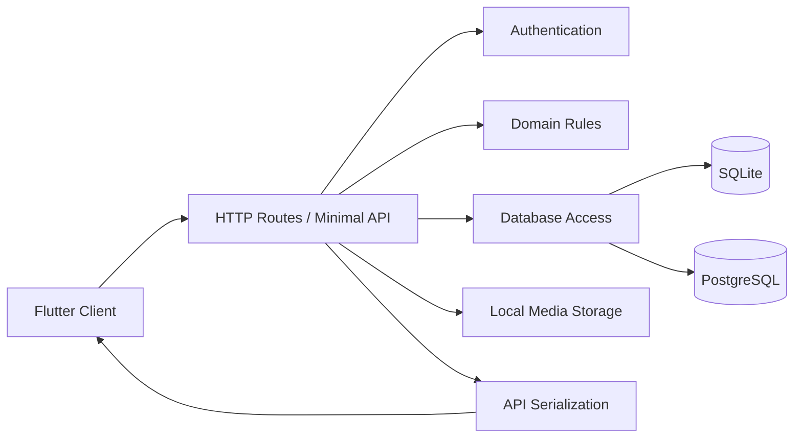
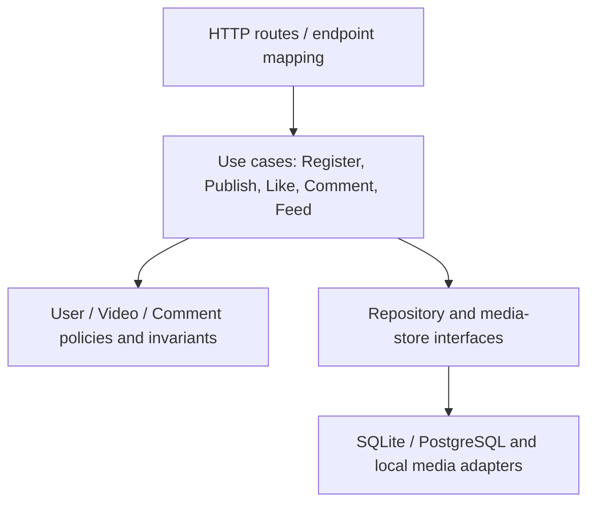

# 后端 DDD 结构分析与优化记录

分析范围：`server/`（Node.js）与 `server-dotnet/`（ASP.NET Core）。本次只做可独立验证的领域逻辑提取，不改变 HTTP 契约或数据库结构。

## 现状摘要

两套后端实现相同的短视频 MVP API，数据模型均包含用户、视频、评论、点赞、关注和播放记录。请求大致沿以下路径流动：

### 限界上下文（从现有代码归纳）

| 上下文 | 主要模型与职责 |
| --- | --- |
| 身份认证 | 用户注册/登录、密码哈希、JWT；`users` |
| 用户与社交 | 用户资料、关注/粉丝关系；`users`、`follows` |
| 视频发布与媒体 | 视频元数据、上传、封面与媒体文件生命周期；`videos`、本地媒体 |
| 互动 | 点赞、评论、播放与分享计数；`likes`、`comments`、`video_views` |
| 内容发现 | 推荐/关注流、搜索、用户推荐；读取用户、视频和社交数据 |

这些是逻辑上下文，不是当前已隔离的模块。两个实现都直接以共享关系数据库表连接多个上下文，暂时没有跨上下文消息或领域事件。

### DDD 构件识别

- **实体候选**：User、Video、Comment；都由数据库主键标识。
- **聚合候选**：User（资料及身份）、Video（发布状态和计数）、Comment（作者与所属视频）。现有代码没有显式聚合或一致性边界。
- **值对象候选**：用户名、资料文本、分页参数、媒体路径；当前主要以原始字符串和数字传递。
- **领域服务候选**：推荐评分；本次将其作为无状态领域策略提取。
- **仓储/领域事件**：没有领域仓储接口或领域事件；Node 路由和 C# Minimal API 处理器直接调用 SQL 数据访问层。

自动 DDD 扫描未识别出实体、仓储或聚合。该结果不代表领域模型不存在：扫描器是基于命名/语言模式的启发式工具，Node 项目使用关系表及函数式路由，C# 项目也不在扫描器支持的语言范围内，因此采用代码和 schema 的人工核对作为依据。

## 主要问题与优先级

| 优先级 | 发现 | 影响 |
| --- | --- | --- |
| 高 | Node 的 `routes/` 同时承载 HTTP、SQL 编排和部分业务规则；C# 的 `ApiEndpoints.cs` 集中注册约 25 个路由，并包含查询、验证、映射和媒体操作。 | 业务变更容易与传输及持久化细节耦合；复用、局部测试和并行维护困难。 |
| 中 | 用户名规则和推荐公式属于领域规则，但直接写在路由/接口实现中；两种语言还要分别维护同一规则。 | 易产生跨实现行为漂移，纯逻辑难以单测。 |
| 中 | Feed、搜索和用户接口会跨视频、用户、关注/点赞等表查询。 | 领域边界主要由 API 文件而不是业务职责表达。 |
| 低 | Node 已有按功能拆分路由、C# 有独立数据库驱动和 seed 服务，但尚未形成 application/use-case 层。 | 当前规模可接受；随着功能增长会继续放大接口层复杂度。 |

## 本次优化

- 新增 Node 领域策略模块：`src/domain/user-policy.js` 与 `src/domain/recommendation.js`，让注册/登录用户名处理和推荐排序脱离路由。
- 新增对应 Node 内置测试，覆盖用户名/密码边界、推荐分数的互动/时间衰减及并列排序。
- 新增 C# `Domain/UserPolicy.cs` 和 `Domain/FeedRecommendation.cs`，Minimal API 通过这些纯业务策略校验用户并计算推荐分数。
- 扩充共享 API 冒烟脚本，验证两端均拒绝不符合领域约束的用户名和密码。
- 不改变路由、错误码、JSON 字段、SQL schema、文件存储或推荐权重。

验证结果：Node 领域单测 5 项通过；Node 和 C# 后端各自通过 26 项共享 API/媒体冒烟检查；C# 解决方案构建通过。

## 建议的渐进目标结构

建议按实际需求逐步推进，而不是立即拆分数据库或改成微服务：

1. 为两端剩余关键用例补充行为测试，并继续将 C# Endpoint 按身份、社交、视频、互动/发现职责拆分。
2. 将 SQL 移入按上下文组织的 repository，use-case 负责事务和授权边界；保持共享 schema 与 API。
3. 把点赞/评论/删除等计数一致性维护留在相应写用例事务中，必要时增加数据库一致性校验。
4. 只有出现真实异步消费者需求时再引入领域事件；只有部署或团队边界要求时再拆分服务。
