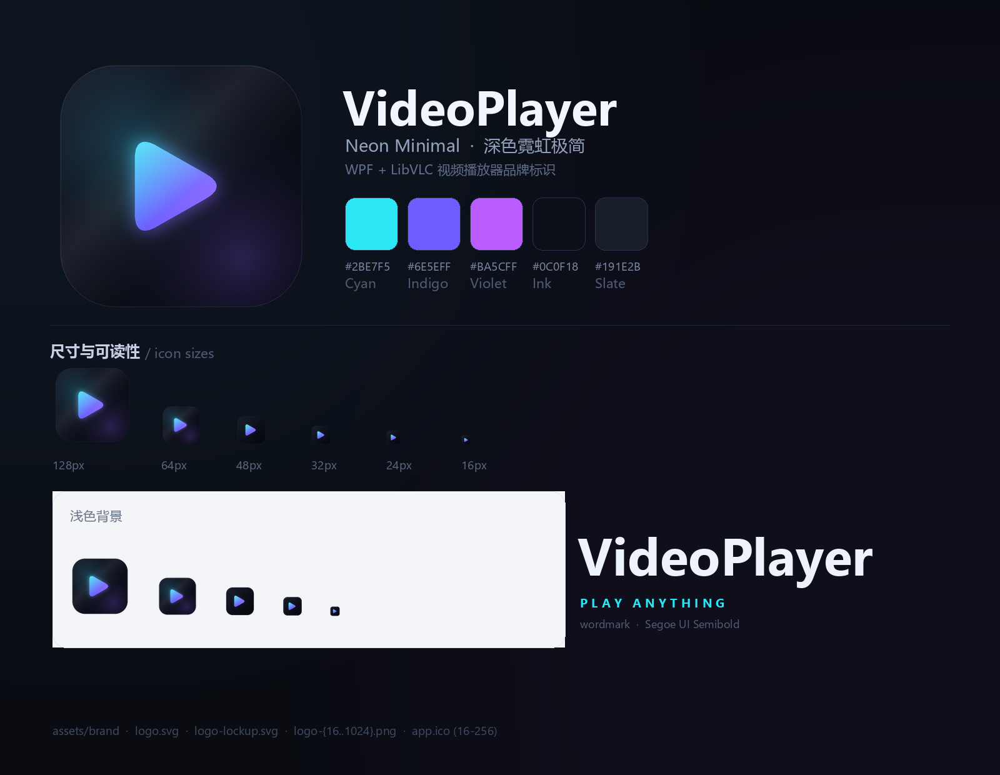

# VideoPlayer 品牌标识

**Neon Minimal · 深色霓虹极简**

深色圆角底板上，一个由「青 → 靛 → 紫」渐变构成的播放三角。
三角自带外发光，像屏幕里透出的光；青色代表画面、紫色代表流媒体数据，
两者在中间交汇成播放这个动作本身。



## 文件

| 文件 | 用途 |
| --- | --- |
| `logo.svg` | 矢量源文件（1024×1024），图标主文件，任意放大不糊 |
| `logo-lockup.svg` | 横版组合标（图标 + 文字），用于关于页、启动页、文档 |
| `logo-lockup.png` | 横版组合标的透明 PNG（1180×320，浅色文字，深底使用） |
| `logo-1024.png` … `logo-16.png` | 各尺寸位图，1024/512/256/128/64/48/32/24/16 |
| `logo.png` | 与 `logo-1024.png` 相同的 1024 主图（通用别名） |
| `app.ico` | Windows 应用图标，内嵌 16/24/32/48/64/128/256 七个尺寸 |
| `preview.png` | 品牌预览页（配色、尺寸、浅色底效果） |
| `tools/generate_logo.py` | 全部资产的生成脚本（唯一几何来源） |

应用图标已经复制到 `src/VideoPlayer/Assets/app.ico`，并通过
`VideoPlayer.csproj` 的 `<ApplicationIcon>` 生效。

## 配色

| 名称 | 色值 | 用途 |
| --- | --- | --- |
| Cyan | `#2BE7F5` | 高亮、强调、进度条已播放段 |
| Indigo | `#6E5EFF` | 主色，按钮与选中态 |
| Violet | `#BA5CFF` | 渐变终点、次要强调 |
| Ink | `#0C0F18` | 应用深色背景 |
| Slate | `#191E2B` | 卡片 / 面板背景 |

播放三角的渐变可复用到界面中：

```xml
<LinearGradientBrush x:Key="BrandAccent" StartPoint="0,0" EndPoint="1,1">
    <GradientStop Color="#2BE7F5" Offset="0" />
    <GradientStop Color="#6E5EFF" Offset="0.55" />
    <GradientStop Color="#BA5CFF" Offset="1" />
</LinearGradientBrush>
```

窗口图标：

```xml
<Window ... Icon="Assets/app.ico" Title="VideoPlayer">
```

## 使用规范

- **留白**：图标四周至少留出图形宽度 1/4 的空白，不要贴边。
- **最小尺寸**：位图最小用到 16px；更小的场景请只用 `logo.svg` 或 `app.ico`。
- **不要**：拉伸变形、旋转、给三角换单色、在三角上叠加文字或描边。
- **深色优先**：标识为深色底板设计，浅色背景上直接使用即可（自带圆角底板）；
  若需要纯透明背景的单色标，请另行导出，不要直接抠掉底板。
- **小尺寸优化**：16/24/32/48px 版本由脚本单独渲染——放大三角、去掉环境光与反光，
  以保证任务栏和资源管理器中依然清晰，因此与 1024 版不是简单的等比缩小。

## 重新生成

```powershell
python assets/brand/tools/generate_logo.py
Copy-Item assets/brand/app.ico src/VideoPlayer/Assets/app.ico -Force
```

依赖：Python 3.10+、Pillow、NumPy。所有几何参数（`TRI`、`PLATE_*`、
`PLAY_STOPS` 等）集中在脚本顶部，改一处即可全量同步 SVG / PNG / ICO。

## 字体说明

组合标文字使用 Segoe UI Semibold（Windows 系统字体），仅作界面内展示没有问题；
若要对外分发品牌物料，建议替换为开源字体（如 Inter、Manrope）以避免授权争议，
替换时只需修改脚本中的 `_font(...)` 调用与 SVG 里的 `font-family`。
